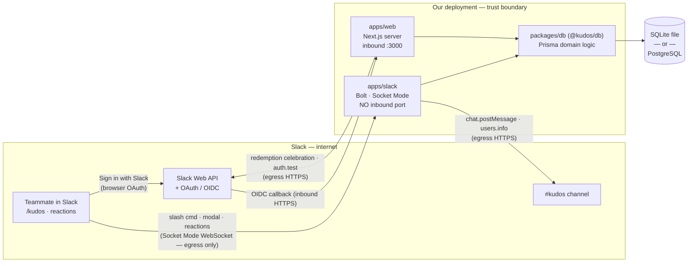
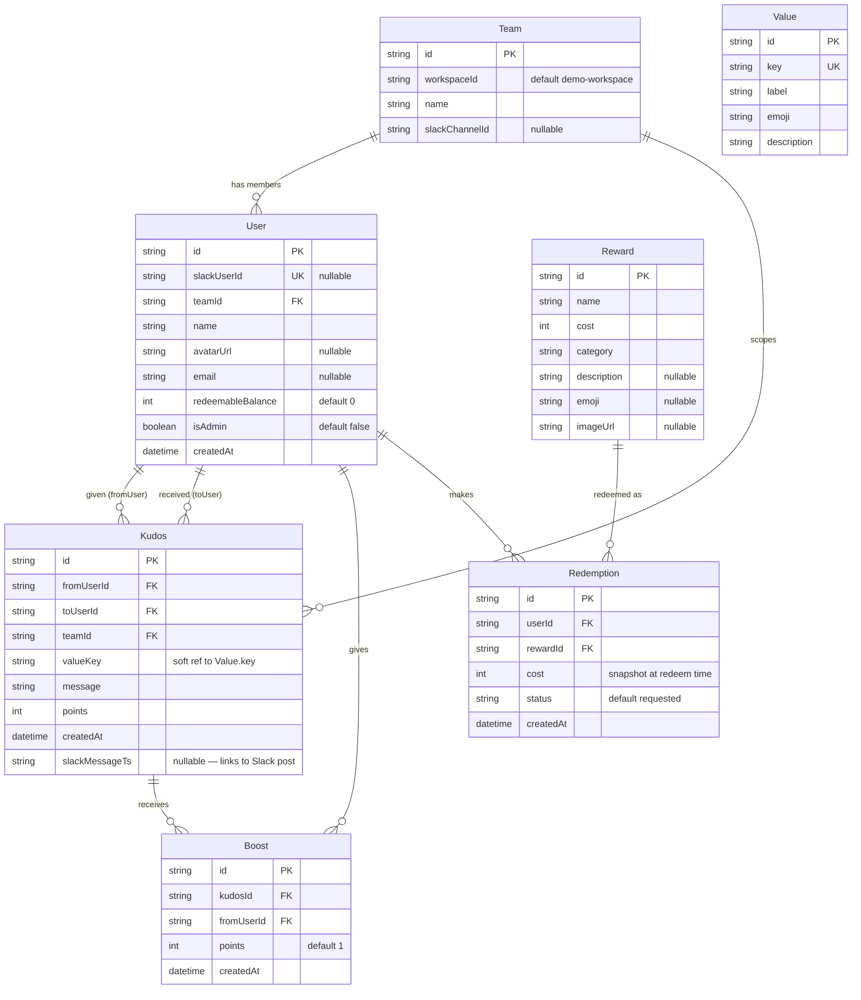
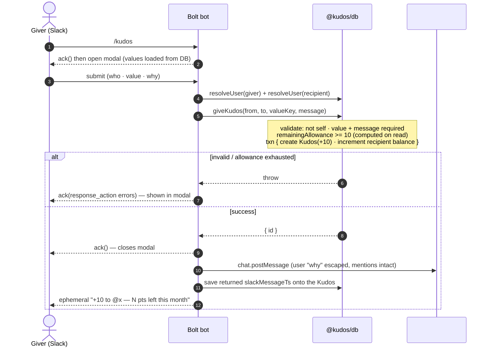
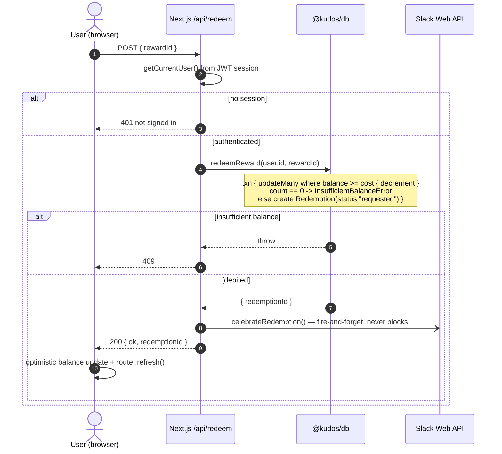
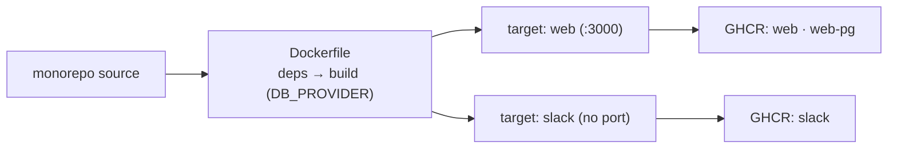

# System Architecture

Kudos is a peer-recognition and rewards platform: give a teammate kudos in Slack in
about ten seconds, watch it land in a live web feed, and turn accrued points into
real rewards. This document is the 10-minute mental model — how the pieces fit, why,
and where the trust boundaries are. It grounds every claim in the code; deeper
operational detail lives in [`database.md`](database.md) and [`docker.md`](docker.md),
and the *why* behind each choice in [`decisions/decision-log.md`](decisions/decision-log.md).

The whole system is **one TypeScript monorepo, two runnable processes, one shared
data model**:

- **`apps/slack`** — a Slack Bolt bot in Socket Mode (where *giving* happens).
- **`apps/web`** — a Next.js App Router server (the feed, rewards store, and the one write API).
- **`packages/db`** — `@kudos/db`: the Prisma schema plus *all* business logic, imported by both processes so a rule can never drift between surfaces.

---

## 1. System context

**Trust boundaries.** The bot is **egress-only**: Socket Mode opens an *outbound*
WebSocket to Slack, so there is no public request URL, tunnel, or signature-verification
surface (`apps/slack/src/app.ts`, `socketMode: true`). The only **inbound** surface is
the Next.js server: browser traffic on `:3000` and the Slack OIDC callback. Everything
the web app sends to Slack (the redemption celebration, the setup `auth.test` probe) is
**egress HTTPS** with the bot token, which never leaves the server. The database is a
local file (SQLite) or a private network peer (Postgres) — never internet-facing.

---

## 2. Data model

Seven models in `packages/db/prisma/schema.prisma`. Money is two separate quantities: a
giver's monthly **give-allowance** (never stored — computed on read, see §5) and a
recipient's stored **`redeemableBalance`**.

Notes that don't show in the diagram: `Boost` has a `@@unique([kudosId, fromUserId])` —
the DB-level guarantee that one person boosts a kudos at most once. `Kudos.valueKey` is a
*soft* reference to `Value.key` (no FK) so seeding values and posting kudos stay
decoupled. `Kudos.slackMessageTs` is the join between a web-feed row and its Slack message,
which is how a reaction later finds its kudos (§3a → §3 boost path). `Redemption.cost` is
snapshotted so later catalog price changes don't rewrite history.

---

## 3. Sequence: give kudos

`/kudos` → modal → immediate `ack()` → domain call → public post → private feedback.
Slack requires an ack within 3 seconds; the code acks the command first, then does work.

Everything after the second `ack()` is best-effort: the kudos already committed, so a
failed channel post or ephemeral feedback is logged, never surfaced
(`apps/slack/src/kudosCommand.ts`). **Boosts** reuse the stored `slackMessageTs`: a
`reaction_added` event looks up the kudos by that timestamp, resolves the reactor, skips
if they are the recipient, and calls `addBoost` (+1, idempotent via the unique constraint,
P2002 swallowed) — `apps/slack/src/boost.ts`, `packages/db/src/kudos.ts`.

---

## 4. Sequence: redeem a reward

The one write path in the web app. Session-authenticated, race-safe debit, fire-and-forget
celebration.

The user id comes only from the signed JWT session (`getCurrentUser()` → `redeemReward`),
never from the request body — the client cannot spend someone else's points. The debit is
a **conditional** `updateMany` (`where redeemableBalance >= cost`): concurrent redeems can
never drive a balance negative, and no read-modify-write race exists
(`packages/db/src/rewards.ts`). The Slack celebration is `void`-ed and swallows its own
errors (`apps/web/lib/slack-celebrate.ts`), so Slack being down or unconfigured can never
turn a successful redemption into a 500.

---

## 5. Module map

| Workspace | Responsibility | Key files | Depends on |
|---|---|---|---|
| `packages/db` (`@kudos/db`) | The core. Prisma schema + client, all domain logic, allowance math, identity linking, seed/demo/catalog data, Vitest suite. | `prisma/schema.prisma`, `src/kudos.ts`, `src/points.ts`, `src/rewards.ts`, `src/users.ts`, `src/period.ts`, `src/client.ts` | Prisma, SQLite/Postgres |
| `apps/slack` (`@kudos/slack`) | Bolt bot, Socket Mode. `/kudos` command + modal, `kudos_submit` view handler, reaction boosts, user sync, demo backfill, token verify. | `src/app.ts`, `src/kudosCommand.ts`, `src/boost.ts`, `src/userSync.ts`, `src/backfill.ts` | `@kudos/db`, `@slack/bolt` |
| `apps/web` (`@kudos/web`) | Next.js App Router UI. Feed, rewards store + confirm dialog, My Rewards history, `/api/redeem`, NextAuth SSO, setup diagnostics. | `app/page.tsx`, `app/rewards/*`, `app/api/redeem/route.ts`, `auth.ts`, `lib/current-user.ts`, `lib/slack-celebrate.ts` | `@kudos/db`, `next`, `next-auth` |

**One language, one data model.** Both processes import their business rules from
`@kudos/db` — `giveKudos`, `addBoost`, `redeemReward`, `remainingAllowance`,
`linkSlackUser`. There is exactly one place to change a rule, one toolchain, one mental
model, and the bot and web app cannot disagree about, say, what a kudos is worth. Web
**reads** go straight through Prisma in server components (no API layer); the only
**write** exposed over HTTP is `/api/redeem`, a thin auth-guarded wrapper over the shared
function. (D5, D6.)

---

## 6. Key design decisions

Rationale lives in the decision log and specs — this is the index.

- **Two-currency point economy.** A monthly *give-allowance* (generosity currency) is
  strictly separate from a *redeemable balance* (reward currency) that's never clawed
  back. Separating them is what resists gaming and keeps giving thoughtful. — D7, D18, D22.
- **Computed-on-read allowance.** `remainingAllowance` = `MONTHLY_ALLOWANCE (100)` minus
  the sum of points a user *gave* in the current UTC calendar month (`points.ts`,
  `period.ts`). Nothing is stored or decremented per-give, so allowance "resets" monthly
  for free and can't drift out of sync. — D21.
- **Race-safe redemption.** Conditional transactional decrement (`updateMany where
  balance >= cost`) instead of read-then-write; balances can't go negative under
  concurrency. Fulfillment uses the same conditional-update idiom for idempotency. — `rewards.ts`.
- **Slack Socket Mode.** Outbound WebSocket, no public URL / ngrok / request-signature
  surface — a judge runs the whole thing from a laptop, and the attack surface shrinks. — D4.
- **`DATABASE_URL` three-mode strategy.** Unset → bundled SQLite `dev.db`; a `file:` URL →
  custom SQLite; a `postgres://` URL → the generated `schema.postgres.prisma`. The Postgres
  schema is *mechanically derived* from the SQLite one (provider swap only) and CI gates
  drift, so the two can never disagree. See [`database.md`](database.md). — `client.ts`,
  `scripts/gen-postgres-schema.ts`.
- **Session-derived identity.** The redeeming user id comes from the signed JWT session,
  never the client. NextAuth links accounts on the Slack user id (not the OAuth `sub`) via
  `linkSlackUser`, giving one identity across bot and web. — `auth.ts`, `users.ts`, D (Slack SSO spec).
- **Fire-and-forget Slack side-effects.** Channel posts, ephemeral feedback, and the
  redemption celebration are all best-effort and isolated from the primary transaction —
  Slack being slow or down never fails a give or a redeem.

Specs: [`superpowers/specs/2026-06-30-kudos-program-design.md`](superpowers/specs/2026-06-30-kudos-program-design.md),
[`superpowers/specs/2026-07-01-slack-sso-design.md`](superpowers/specs/2026-07-01-slack-sso-design.md).

---

## 7. Deployment topologies

One multi-stage `Dockerfile` produces two runnable targets (`web`, `slack`) from a single
install + build; a `DB_PROVIDER` build arg bakes either the SQLite or Postgres Prisma
client. Details in [`docker.md`](docker.md) and [`database.md`](database.md).

| Topology | How | Database | Notes |
|---|---|---|---|
| Local dev | `npm run dev:web` + `npm run dev:slack` | Bundled SQLite `dev.db` (zero-config) | Fastest loop; `db:push` + `db:seed` in seconds. |
| Compose (SQLite) | `docker compose up` | Named volume `kudos-db`, shared by both containers | Web publishes `:3000`; slack has no port (Socket Mode). |
| Compose + Postgres | `build --build-arg DB_PROVIDER=postgres`, `--profile postgres` | Bundled `postgres:16` service | `db:pg:migrate` to apply migrations; not `db:push`. |
| Prebuilt GHCR images | `docker compose -f docker-compose.ghcr.yml up` | Volume or external Postgres | CI publishes `web`, `slack`, and a `-pg` web variant to GHCR. |

CI (`.github/workflows/ci.yml`) runs the Vitest suite, creates the SQLite schema, and gates
Postgres-schema drift; `docker.yml` builds and pushes the images to GHCR on `main` and tags.

---

## 8. Known limitations

Honest scope. Redemptions are **manually fulfilled by design** — a redeem logs a
`status: "requested"` row for a human to action; there is no gift-card API or automated
fulfillment (this is the deliberate lean-core boundary, D9). The data model carries
`teamId` / `workspaceId` for future multi-team federation, but the web queries are **not
yet team-scoped** — today's deployment is effectively **single-team** (`linkSlackUser`
attaches new users to the first team). There is **no observability stack** (no metrics,
tracing, or structured logging beyond `console.error`), and the pre-transaction validation
checks in `giveKudos`/`redeemReward` have a bounded TOCTOU window that is safe under the
single-worker deployment but would want row-level locking at scale. **SQLite is intended
for small teams and the demo**; a real multi-user deployment should move to Postgres (a
datasource change, not a rewrite — see [`database.md`](database.md)).
