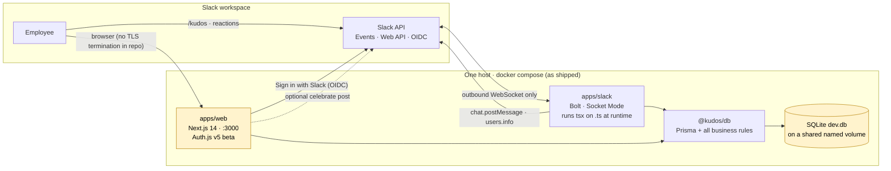

# 1 · Where we are — current-state review

_Reviewed 2026-11-05 against `main` @ `docs: adopt merged-product roadmap as plan of record` (2026-07-29). Everything below was verified by running it or reading it; file paths are the evidence._

## Verdict

**The product is MVP-worthy for an internal pilot. The repo is not deployable as a company service today.** The core loop (give in Slack → feed → redeem → admin fulfils) works, the business logic is tested, and the security basics inside the app are better than a hackathon entry has any right to be. Everything that blocks a pilot is *around* the app: dependencies, delivery pipeline, auth boundary, repo hygiene. None of it is hard; it is roughly 1–2 days of focused work plus the Next.js upgrade.

## What was verified

| Check | Result | How |
|---|---|---|
| Unit tests | **34/34 pass** (`rewards` 18, `kudos` 7, `users` 4, `points` 3, `period` 2) | `npm test` |
| Typecheck | clean | `npx tsc --noEmit` in `apps/web` (not a CI gate today) |
| Web build | clean | CI `build` job, last run 2026-07-29 green |
| CI | green on `main` | `.github/workflows/ci.yml` |
| Docker publish | **failing since 2026-07-29** | `.github/workflows/docker.yml` — see F2 |
| Pages showcase | **failing since 2026-07-18** | `.github/workflows/pages.yml` — see F2 |
| Git history | clean — no `.env`, no `.db`, no real secrets | `git ls-files`, roadmap §3 verification |
| Dependency audit | **111 open Dependabot alerts**, ~90 in runtime deps | `npm audit`, `gh api .../dependabot/alerts` |

## As-built architecture

The 10-minute mental model and system-context diagram live in [`../architecture.md`](../architecture.md); this is the deployment view as it exists today.

Highlighted: SQLite-on-a-volume with two writers is the demo path, not the production one; the web tier carries the vulnerable Next/Auth.js versions.

## Scorecard

| Area | Status | Notes |
|---|---|---|
| Core product loop | 🟢 | Give, boost, feed, SSO, store, redeem, history, admin queue + catalog, first-run `/setup` diagnostics |
| Business-logic tests | 🟢 | `packages/db/src/*.test.ts`; race-safe redeem and allowance cap are covered |
| In-app security | 🟡 | Session-derived user on `/api/redeem`, admin re-checked in server actions, Slack text escaping, no secrets echoed by `/setup`. Missing: workspace allowlist on sign-in (F3), rate limiting |
| Dependencies | 🔴 | F1 |
| Delivery pipeline | 🔴 | Images not publishing (F2); no security gates; no typecheck/lint gate |
| Test coverage breadth | 🟡 | Zero tests for `apps/slack` handlers or `apps/web` routes; no E2E; no compose smoke test |
| Runtime hardening | 🟡 | No health endpoint, no `HEALTHCHECK`, image runs as root with devDeps + source |
| Data / ops | 🟡 | Postgres path exists (schema gen + migrations + CI drift gate) but migrations are a manual step; no backup story; `console.*` logging only |
| Docs | 🟡 | Excellent design/decision trail; README/BACKLOG stale and still point at `brandonrc/kudos-bounty` |
| Repo controls | 🔴 | No branch protection on `main`; no `dependabot.yml`; Pages not configured on the org repo |

## Findings

Severity is about *impact on running this as a company service*, not CVSS.

### F1 · Runtime dependencies carry known critical vulnerabilities — 🔴 blocker
- **Evidence:** `npm audit --omit=dev` → `next@14.2.35` (50 alerts incl. 6 critical: unauthenticated RCE in the image-optimization API, response-cache confusion, SSRF), `next-auth@5.0.0-beta.25` + `@auth/core` (critical), plus transitive `axios`, `follow-redirects`, `proxy-addr` (critical), `qs`, `postcss`, `nanoid`, `body-parser`.
- **Why it happened:** no `.github/dependabot.yml`, no `npm audit` in CI, nothing has moved since July.
- **Fix:** upgrade Next → 16 / React → 19 / Tailwind → 4 (already planned as roadmap P0a), `next-auth` to current, `npm audit fix` for transitives; then Dependabot + an audit gate so it can't recur. → Epic **E2** (#19)
- **Also behind, not urgent:** `prisma` 5→7, `@slack/bolt` 3→5, `@slack/web-api` 6→8, `vitest` 2→5 (dev-only criticals in `tinypool`).

### F2 · Delivery pipeline broke on the org transfer — 🔴 blocker
- **Evidence:** `.github/workflows/docker.yml:17-18` pushes to `ghcr.io/brandonrc/kudos-bounty-{web,slack}`; the org repo's `GITHUB_TOKEN` cannot write to a personal namespace, so the 2026-07-29 run failed. `docker-compose.ghcr.yml`, README badges, and `pages.yml` all still reference `brandonrc/kudos-bounty`. Pages has failed since 07-18 (the workflow's own comment says the repo setting "Source: GitHub Actions" must be set first).
- **Fix:** repoint images to `ghcr.io/openteams-ai/kudos-{web,slack}`, update compose/README/Pages URL, set the Pages source, re-run. → **E1** (#18)

### F3 · Sign-in has no workspace boundary — 🔴 blocker before anyone outside the team can reach the URL
- **Evidence:** `apps/web/auth.ts` `signIn` callback accepts any Slack identity; `packages/db/src/users.ts` `linkSlackUser` then creates the user in `prisma.team.findFirstOrThrow()`.
- **Mitigation today:** a Slack app that is *not distributed* can only be authorized by members of the workspace that created it. That is a Slack-side setting one checkbox away from changing.
- **Fix:** allowlist the `https://slack.com/team_id` OIDC claim (env `AUTH_SLACK_TEAM_ID`) in `signIn`; fail closed. → **E3** (#20)

### F4 · No repo protections — 🔴
- **Evidence:** `GET /branches/main/protection` → 404. Anyone with write can push to `main` with red CI.
- **Fix:** branch protection requiring `ci / test + schema drift` and `ci / web build`, PR required, no force-push. → **E1** (#18)

### F5 · Single-writer assumptions — 🟡 constraint, document and respect
- `giveKudos` checks the monthly allowance *before* its transaction (`packages/db/src/kudos.ts`), a documented TOCTOU (`docs/decisions/decision-log.md:173`). The Slack bot must run as exactly one replica (two would double-handle every event). Safe for a pilot at one web replica; the derived-balance + escrow design in roadmap Gate C is the real fix. → noted in **E6** (#23), fixed in roadmap P0

### F6 · Name-match account linking — 🟡
- `linkSlackUser` links a *new* Slack identity to any unlinked `User` with the same display name. Harmless with `db:seed` (no demo humans); with `db:demo` loaded, a real sign-in named "Ada Lovelace" inherits the demo admin. → **E3** (#20) (never load demo data in prod; add `nameCustomized`-style guard from roadmap P1)

### F7 · No health signal, root container, fat image — 🟡
- No `/api/health`; no Docker `HEALTHCHECK`; `Dockerfile` never sets `USER`; runtime stage copies the full build tree including devDependencies, and the bot runs `tsx` over TypeScript at runtime. → **E6** (#23)

### F8 · No security or quality gates in CI — 🟡
- CI runs unit tests, the Postgres schema-drift check, and the web build. No `tsc`, no lint, no `npm audit`, no CodeQL, no image scan, no SBOM. Secret scanning / push protection not confirmed enabled on the org repo. → **E4** (#21)

### F9 · No tests above the domain layer — 🟡
- `apps/slack` handlers (`kudosCommand.ts`, `boost.ts`) and `apps/web` routes/actions have no tests; the compose stack has never been exercised in CI. → **E5** (#22)

### F10 · Operational basics absent — 🟡
- Migrations are a manual `docker compose run … db:pg:migrate`; no backup/restore procedure; `console.*` logging with no request correlation; no metrics. Slack `token_rotation_enabled: false`. → **E6** (#23)

### F11 · Docs drift — ⚪
- README says 22 tests (34), BACKLOG says redemption history is not started (shipped), badges and showcase URL point at the old repo, `@kudos/*` scope rename still open. → **E1** (#18)

## What is genuinely good (keep it)

- The domain layer is small (≈300 lines), tested, and shared by both surfaces — the "no drift" property is real today.
- Socket Mode means **no inbound webhook** — the only inbound surface is the web app behind SSO.
- Redeem is race-safe by construction (`updateMany where balance >= cost`), and the IDOR on redeem was found and fixed by review before the hackathon ended.
- Postgres is a build-arg away, with generated schema, migrations, and a CI drift gate.
- The decision log and research trail mean a new maintainer can learn *why*, not just *what*.
