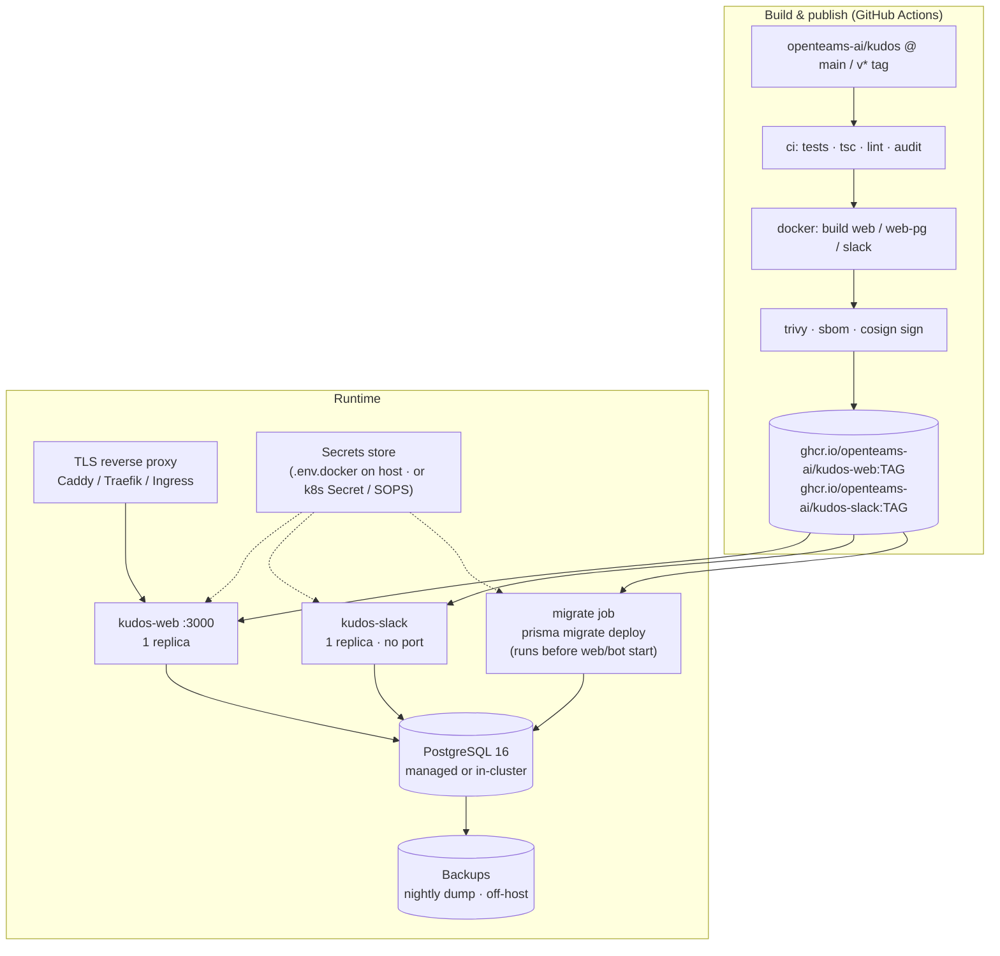
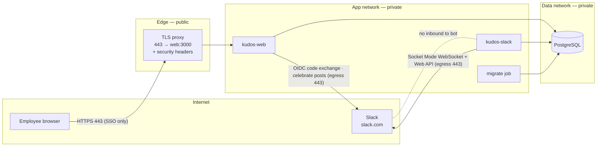
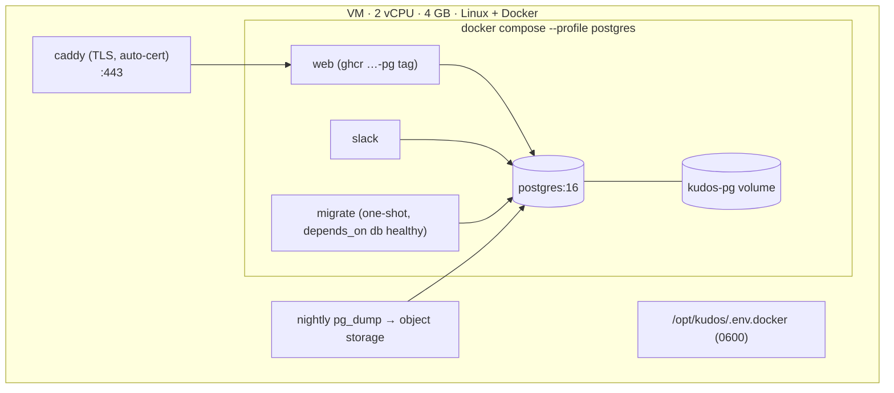
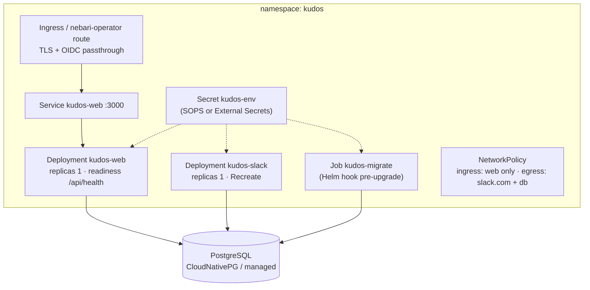

# 2 · Infrastructure — target deployment design

_What it takes to run Kudos as an internal OpenTeams service. Two deployment options are designed; both share the same images, secrets, and data model. Open decisions are listed at the end._

## Design constraints (from the code)

| Constraint | Source | Consequence |
|---|---|---|
| Slack bot is **Socket Mode** | `apps/slack/manifest.yaml` `socket_mode_enabled: true` | No inbound port, no public webhook, no request-signing to get wrong. Bot needs egress to `slack.com` only |
| Bot must be **exactly one replica** | Each replica receives every Socket Mode event | Deployment `replicas: 1`, `strategy: Recreate` |
| Web should be **one replica** until roadmap Gate C lands | Allowance check is pre-transaction (`kudos.ts`) | Fine for company scale; horizontal scaling is a later problem |
| Web needs a **public HTTPS URL** for Slack OIDC | `AUTH_URL`, Slack redirect URL | TLS termination in front of `:3000` |
| Database: **PostgreSQL for anything real** | SQLite-on-a-volume with two writers is a demo path | Postgres Prisma client is a build arg (`DB_PROVIDER=postgres`, `-pg` image tags) |
| Everything is config-by-env | `apps/web/.env.local.example`, `apps/slack/.env.example` | 7 secrets/settings, listed below |

Company-scale sizing: tens to low hundreds of users, a few hundred kudos a month. **One small node is enough.** This is an availability-tolerant internal tool; the SLO is "works during business hours, restored from backup within a day", not five nines.

## Components

## Network & trust boundaries

| Flow | Direction | Port | Required |
|---|---|---|---|
| Browser → proxy → web | inbound | 443 → 3000 | yes — the only inbound surface |
| web → slack.com | egress | 443 | yes (OIDC); celebrate posts optional |
| bot → slack.com | egress | 443 (WSS) | yes |
| web/bot/migrate → Postgres | internal | 5432 | yes; never exposed publicly |
| Anything → bot | inbound | — | **none** |

Recommended proxy headers: HSTS, `X-Content-Type-Options: nosniff`, `Referrer-Policy: strict-origin-when-cross-origin`, a CSP once the Next 16 upgrade is in (Next emits nonces for inline scripts). Consider restricting 443 to the company network / VPN / Tailscale if the hosting target allows — the app has no anonymous surface beyond the sign-in page anyway.

## Configuration & secrets

| Variable | Used by | Secret? | Rotation |
|---|---|---|---|
| `DATABASE_URL` | web, bot, migrate | yes (contains password) | on DB credential rotation |
| `AUTH_SECRET` | web | yes | rotate = all sessions sign out; fine for an internal tool |
| `AUTH_URL` | web | no | — |
| `AUTH_SLACK_ID` / `AUTH_SLACK_SECRET` | web | secret | Slack app → Basic Information → regenerate |
| `AUTH_SLACK_TEAM_ID` *(new, F3)* | web | no | — |
| `SLACK_BOT_TOKEN` (`xoxb-`) | bot, web (optional celebrate) | yes | reinstall app or enable Slack token rotation |
| `SLACK_APP_TOKEN` (`xapp-`) | bot | yes | Slack app → App-Level Tokens |
| `SLACK_KUDOS_CHANNEL` | bot, web | no | — |

Rules: secrets live in the host's `.env.docker` (mode 600) or a Kubernetes `Secret` (SOPS/age-encrypted in git if GitOps). Never in the image, never in the compose file, never in CI logs. The `/setup` page already prints only booleans/masked values — keep it that way.

## Data

- **Engine:** PostgreSQL 16. Managed (RDS/Cloud SQL) if the hosting target has it; otherwise the `postgres:16-alpine` service from `docker-compose.yml` with a **changed password** and a persistent volume.
- **Migrations:** `prisma migrate deploy --schema=prisma/schema.postgres.prisma` runs as a one-shot job/init container *before* web and bot start — not a human typing `docker compose run`. Migration files are generated from `schema.prisma` and gated in CI (`db:pg:schema:check`); hand-editing `schema.postgres.prisma` is forbidden.
- **Backups:** nightly `pg_dump -Fc` to off-host storage (object store bucket or a different machine), 30-day retention, **restore tested once** before go-live and after each major upgrade. The dataset is tiny; a dump takes seconds.
- **Data classification:** names, work emails, Slack user IDs, avatar URLs, free-text recognition messages, reward redemptions. Internal/PII-light. No payment data, no credentials. See [`04-security.md`](04-security.md).
- **Seeding:** production gets `db:seed` only (values + catalog). **Never** `db:demo` — it creates fake humans and a demo admin (F6).

## Option A — single VM with docker compose (recommended first step)

Fastest path to a pilot; everything in the repo already targets this.

Deploy = `docker compose pull && docker compose up -d` with pinned `WEB_TAG`/`SLACK_TAG` (never `latest` in prod). Rollback = set the previous tag and `up -d` again; migrations are additive, so the previous image keeps working against the newer schema for one version. Upgrades with destructive migrations get a backup first, by policy.

Needs added to the repo: a `migrate` service in compose, a `caddy` (or Traefik) service with the hostname, `HEALTHCHECK`s, and a `scripts/backup.sh`. (→ Epic **E6** (#23))

## Option B — Kubernetes / Nebari

Same images, same env. Use when the company already runs the cluster and wants it under the same GitOps and monitoring.

Packaging: a small Helm chart (or a Nebari software pack, which is the house style) with values for image tags, hostname, and the secret reference. Readiness/liveness need the `/api/health` endpoint (F7). The bot has no port; use an exec/log-based liveness or just rely on `restartPolicy` — Bolt reconnects the socket itself.

## Image hardening (both options)

- Multi-stage already; add: `USER node`, `npm ci --omit=dev` in the runtime stage, compile the bot (`tsc` → `node dist/app.js`) instead of `tsx` at runtime, Next `output: "standalone"` to shrink the web image, `HEALTHCHECK` in both targets, OCI labels from `metadata-action` (already present).
- Pin the base image by digest (`node:20-alpine@sha256:…`) and let Dependabot bump it.
- Scan with Trivy in CI; sign with cosign; attach an SBOM (see [`03-support.md`](03-support.md)).

## Observability (minimum viable)

- `GET /api/health` → `{ ok, db: "up"|"down", version }` with a cheap `SELECT 1`; used by compose `HEALTHCHECK`, k8s probes, and uptime checks.
- Structured JSON logs to stdout with a request id (Next middleware + a tiny logger in `@kudos/db`); ship wherever the host already ships logs.
- Metrics: optional. A `/api/metrics` with kudos-given/redeemed counters is a nice-to-have, not a gate.
- Alerting: one uptime check on `/api/health` and one on "bot logged *running (Socket Mode)* within the last hour". That is the whole on-call surface for a tool of this size.

## Runbook skeleton (to be filled in E6)

| Procedure | Summary |
|---|---|
| First deploy | create Slack app from manifest → set redirect URL + user scopes → fill `.env.docker` → `compose up db` → migrate → `db:seed` → `compose up` → sign in → set `isAdmin` for the first admin → verify `/setup` locks |
| Upgrade | bump `WEB_TAG`/`SLACK_TAG` → backup → `compose pull` → migrate runs → `up -d` → check `/api/health` and a `/kudos` smoke |
| Rollback | previous tag → `up -d` (schema is forward-compatible for one version) |
| Restore | `pg_restore` the last dump into a fresh DB → point `DATABASE_URL` → restart |
| Rotate Slack tokens | regenerate in Slack → update secret → restart bot/web |
| Lost admin | `update "User" set "isAdmin"=true where email='…'` (documented in `docs/setup.md`) |

## Open decisions

1. **Hosting target** — VM (Option A) vs. the Nebari cluster (Option B). Recommendation: **A for the pilot**, B when it needs to live with everything else. Nothing in the repo prevents moving later.
2. **Network exposure** — public HTTPS (SSO is the gate) vs. VPN/Tailscale-only. Recommendation: company-network only if cheap; otherwise public with the team allowlist (F3) and headers above.
3. **Managed vs. in-compose Postgres** — in-compose is fine for the pilot *with* backups; managed when the hosting target offers it.
4. **Slack app ownership** — the production Slack app should be owned by a shared admin account, not an individual.
