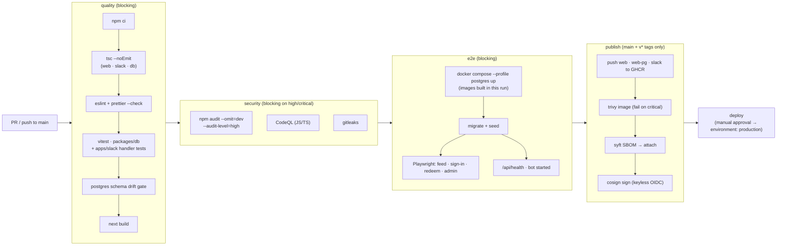
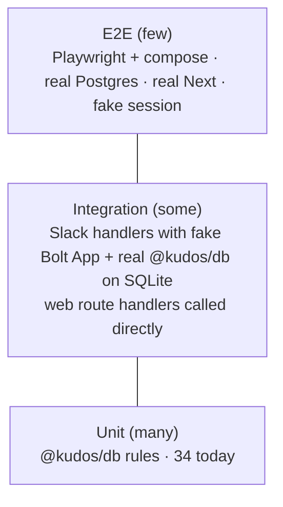

# 3 · Support — pipeline, testing, maintenance, operations

_How a two-person team keeps this safe and running without it eating their week. Everything here is designed to be automated; the humans review PRs and respond to the occasional alert._

## Target CI/CD pipeline

### Gates

| Stage | Tool | Blocks merge? | Status today |
|---|---|---|---|
| Typecheck | `tsc --noEmit` per workspace | yes | passes, **not wired** |
| Lint/format | `eslint` (next/core-web-vitals + ts) · `prettier` | yes | **none** |
| Unit | `vitest` | yes | wired (34 tests) |
| Slack handler tests | `vitest` with a fake Bolt `App` | yes | **none** |
| Schema drift | `db:pg:schema:check` | yes | wired |
| Build | `next build` | yes | wired |
| Dependency audit | `npm audit --omit=dev --audit-level=high` | yes | **none** |
| SAST | CodeQL default setup (free for public repos) | on high | **none** |
| Secrets | gitleaks action + GitHub secret scanning & push protection | yes | **unconfirmed** |
| E2E | Playwright against compose stack | yes | **none** |
| Image scan | Trivy (`image`, `--severity CRITICAL,HIGH`, `--ignore-unfixed`) | critical | **none** |
| SBOM + signature | syft + cosign keyless | no (informational) | **none** |
| Deploy | GitHub environment with required reviewer | manual | **none** |

Keep it to two workflow files: `ci.yml` (quality + security + e2e, on PR and main) and `release.yml` (publish + sign + deploy, on main and tags). Delete `docker.yml` once `release.yml` replaces it.

## Dependency policy

- **Dependabot** (`.github/dependabot.yml`): `npm` weekly, grouped — `minor-and-patch` as one PR, majors individually; `github-actions` weekly; `docker` weekly (base image digest). Auto-merge the grouped minor/patch PR when CI is green (GitHub auto-merge, protected by the gates above).
- **Security advisories:** Dependabot security updates on; treat *critical/high in runtime deps* as "fix this week", moderate as "next grouped PR".
- **Majors:** `next`, `react`, `prisma`, `@slack/bolt` get a human and a changelog read. The 34 unit tests + E2E are the net; a major bump PR must include a run of the E2E suite.
- **Audit gate** in CI makes drift visible on every PR instead of in a 111-alert pile.
- **Node:** track the `.nvmrc` (20) to the current LTS; bump with the base image.

## Security scanning — what runs where

| Layer | Scanner | Where | Policy |
|---|---|---|---|
| Source | CodeQL | GitHub Actions / code scanning | fix high+ before merge |
| Secrets | GitHub secret scanning + push protection, gitleaks in CI | repo setting + Actions | block |
| Dependencies | Dependabot alerts, `npm audit` gate | repo + Actions | high+ blocks |
| Container | Trivy image scan | release workflow | critical blocks publish |
| Supply chain | SBOM (syft, SPDX) attached to the image, cosign keyless signature, provenance attestation (`actions/attest-build-provenance`) | release workflow | informational; consumers verify with `cosign verify` |
| Runtime config | `/setup` diagnostics (booleans only) | app | keep secret-free |

This is the same Trivy/SBOM/cosign shape already used in the team's `nebari-security-posture-pack` and `provenance-collector-pack`; reuse those workflow steps rather than inventing new ones.

## Test strategy

### Unit — `packages/db` (exists)
Keep. Remove the `fileParallelism: false` constraint by giving each test file its own SQLite file (`DATABASE_URL=file:./test-<name>.db`) so the suite can run in parallel.

### Integration — Slack handlers (new)
`registerKudosCommand(app)` and `registerBoost(app)` take an `App`. Pass a fake that records listeners, then invoke them with hand-built `ack`, `client` (`users.info`, `chat.postMessage`, `views.open` as `vi.fn()`), `body`, `view`, `event`. Assert on DB state via `@kudos/db` and on the Slack calls. Covers: modal open, submit with insufficient allowance → `response_action: errors`, self-recognition blocked, successful give posts to channel and stores `slackMessageTs`, reaction on a kudos adds one boost and never a second, reaction on a non-kudos message is ignored.

### Integration — web (new)
Call `POST` in `apps/web/app/api/redeem/route.ts` directly with a mocked `auth()`; cover 401, 400, 409 (insufficient), 404, 200. Same for `admin/actions.ts` (non-admin is a no-op).

### E2E — Playwright (new)
- **Stack:** `docker compose --profile postgres` using the images built earlier in the same run; `migrate` + `db:seed` + a small E2E fixture (two users, one admin, one 50-pt balance) loaded via a `packages/db/prisma/e2e-seed.ts`.
- **Auth without Slack:** do **not** add a test login to the app. Playwright mints the Auth.js session cookie itself: `encode({ token: { userId }, secret: AUTH_SECRET, salt: "authjs.session-token" })` from `next-auth/jwt`, set as the cookie on the context. The app's `getCurrentUser()` then resolves normally. Zero production code paths change for tests.
- **Scenarios (keep to ~6):** feed renders seeded kudos; unauthenticated `/rewards` shows sign-in; authenticated user redeems an affordable reward → confetti → appears in history and balance drops; cannot redeem an unaffordable one; admin sees queue and fulfils it; non-admin gets 404 on `/admin`; `/setup` is 404 in production mode once an admin exists.
- **Bot smoke:** assert the slack container logs `Kudos Slack app running` with dummy tokens? Socket Mode needs a real `xapp-` token to connect — so the bot smoke in CI is "process starts and fails *only* on Slack auth", or use a repo-secret test workspace token on `main` only. Decide in E5.
- **Runtime budget:** < 5 minutes; runs on every PR.

## Release process

- Trunk-based. `main` is always deployable; every merge publishes `sha-<commit>` tags.
- A release is a tag `vX.Y.Z` (semver, start at `v0.1.0` for the pilot) → `release.yml` publishes `X.Y.Z` / `X.Y` / `latest` image tags, signs them, and creates a GitHub Release with auto-generated notes (`gh release create --generate-notes`; label PRs `feat`/`fix`/`chore` for grouping).
- Deploy pins the tag in `.env.docker` / Helm values; `latest` is never deployed.
- `CHANGELOG.md` is the release notes — don't maintain it by hand.

## Operations

### Routine (automated)
Dependabot PRs auto-merge when green; nightly backups; uptime checks on `/api/health` and the bot heartbeat line.

### Human work, expected cadence
| Task | Who | How often |
|---|---|---|
| Review/merge major-version Dependabot PRs | either | monthly-ish |
| Triage code-scanning / audit failures | either | when red |
| Rotate Slack tokens, `AUTH_SECRET` | owner | yearly or on suspicion |
| Restore drill | owner | before go-live, then after major upgrades |
| Admin ops: fulfil redemptions, edit catalog | program owner (non-engineer) | weekly via `/admin` |

### Runbook — symptoms → action
| Symptom | Likely cause | Action |
|---|---|---|
| `/kudos` says "dispatch_failed" or nothing | bot down / `xapp-` token invalid / Socket Mode disabled | `docker compose logs slack`; `npm -w @kudos/slack run verify`; check Slack app → Socket Mode |
| Sign-in loops or `redirect_uri` error | `AUTH_URL` ≠ Slack redirect URL | fix one of them; reinstall app if scopes changed |
| Redeem returns 500 | DB down or migration not applied | `/api/health`; run migrate job |
| `/setup` is 404 | by design once an admin exists | sign in as admin, or flip `isAdmin` in DB |
| Reaction doesn't boost | reaction not on a bot-posted kudos, or user boosting their own | expected; check `slackMessageTs` on the kudos |
| Image push fails in CI | GHCR permissions / wrong namespace | `packages: write` on the workflow, image under `ghcr.io/openteams-ai/…` |

## Review checklist for DevOps / Security sign-off

- [ ] `ci.yml` has tsc, lint, unit, handler tests, drift, build, audit, CodeQL, gitleaks, E2E — all required by branch protection
- [ ] `release.yml` publishes to `ghcr.io/openteams-ai/kudos-*`, scans with Trivy, attaches SBOM, signs with cosign, deploys through a protected environment
- [ ] `dependabot.yml` present; grouped auto-merge working
- [ ] Secret scanning + push protection enabled on the repo
- [ ] Branch protection on `main`: PR required, required checks, no force-push, linear history
- [ ] Images: non-root, prod deps only, pinned base digest, `HEALTHCHECK`
- [ ] Secrets only in `.env.docker`/k8s Secret; `/setup` leaks nothing
- [ ] Backups running and a restore has been performed once
- [ ] Runbook above filled in with real hostnames and owners
- [ ] Threat model in [`04-security.md`](04-security.md) reviewed and accepted risks signed
