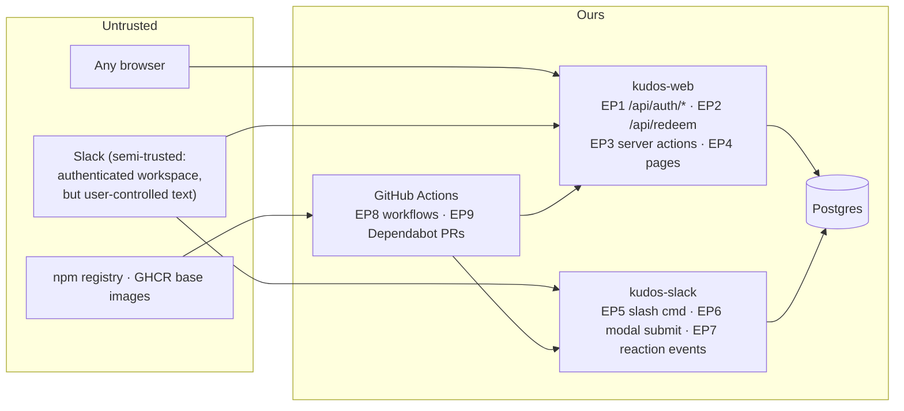

# 4 · Security review — threat model, controls, sign-off

_For the security reviewer. Scope is Kudos as an internal OpenTeams service: the web app, the Slack bot, the database, and the delivery pipeline. Written against `main` as of 2026-11-05._

## Data inventory

| Data | Where | Classification | Notes |
|---|---|---|---|
| Name, work email, Slack user id, avatar URL | `User` | Internal · PII-light | sourced from Slack on sign-in / first `/kudos` |
| Recognition messages (free text) | `Kudos.message` | Internal | written by employees about employees; could contain sensitive remarks |
| Points, balances, redemptions | `User.redeemableBalance`, `Redemption` | Internal · has monetary consequence | redemption → real swag/gift card via a human |
| Slack message timestamps | `Kudos.slackMessageTs` | Internal | links DB rows to channel messages |
| Secrets | env only | Confidential | 5 secrets, see [`02-infrastructure.md`](02-infrastructure.md) |

No payment data, no passwords (SSO only), no customer data.

## Trust boundaries & entry points

| Entry point | Auth today | Input handling today |
|---|---|---|
| EP1 `/api/auth/*` (Auth.js) | Slack OIDC; **no workspace restriction** | Auth.js |
| EP2 `POST /api/redeem` | session JWT → `getCurrentUser()` | body parsed, `rewardId` type-checked; balance guard in DB |
| EP3 server actions (`admin/actions.ts`, `setup/actions.ts`) | re-check `isAdmin` / setup gate inside each action | field length clamps, numeric parse, validation in `@kudos/db` |
| EP4 pages | `/admin` → 404 unless admin; `/setup` self-locking; `/rewards` gated | server components |
| EP5–7 Slack | Socket Mode: the app-level token *is* the auth; Slack has already authenticated the user | messages escaped before posting (`slackEscape.ts`); required fields; self-kudos blocked |
| EP8 workflows | `GITHUB_TOKEN`, least privilege set in `docker.yml` | third-party actions pinned to major tags only |
| EP9 Dependabot | n/a | **no config** |

## Threat model

| # | Threat | Current control | Gap | Action (epic) |
|---|---|---|---|---|
| T1 | Someone outside OpenTeams signs in with their own Slack account and gets a user record (and, via name-match, possibly an existing balance) | App is not distributed → only our workspace can authorize | One Slack checkbox away; nothing in code | Allowlist `team_id` claim in `signIn`; fail closed (**E3** (#20)) |
| T2 | Exploitation of known vulnerabilities in `next` (RCE in image optimizer, cache poisoning, SSRF) and `next-auth` | none — vulnerable versions deployed | 111 open alerts | Upgrade + audit gate (**E2** (#19), **E4** (#21)) |
| T3 | User redeems more than their balance / races two redeems | conditional decrement in one transaction; session-derived user | — | none; keep the test |
| T4 | User gives more than the monthly allowance by racing two `/kudos` submissions | pre-transaction check (TOCTOU) | real but bounded: single bot replica serializes Slack events in practice | Accept for pilot; fix with derived balances/escrow (roadmap Gate C) |
| T5 | Non-admin fulfils redemptions / edits catalog by calling server actions directly | every action re-checks `isAdmin` | — | keep; add a handler test (**E5** (#22)) |
| T6 | Admin bootstrap abuse: first-run `/setup` is open until an admin exists | self-locking gate; page prints no secrets; Slack test rate-limited | window between deploy and first admin | Document "set admin immediately after first deploy"; consider `ADMIN_EMAILS` env to auto-promote (**E3** (#20)) |
| T7 | Malicious text in a kudos message breaks Slack formatting / injects mentions | `slackEscape.ts` escapes `<`, `>`, `&` before `chat.postMessage` | web renders via React (escaped by default) | keep; add a test with `<!channel>` / `<@U…>` payloads (**E5** (#22)) |
| T8 | Secrets leak via logs, `/setup`, image layers, CI | `/setup` masks; `.env` ignored; Dockerfile doesn't carry build-time `DATABASE_URL` into runtime | gitleaks/secret-scanning not confirmed; no push protection | Enable + gitleaks in CI (**E4** (#21)) |
| T9 | Compromised dependency / base image (supply chain) | lockfile + `npm ci` | no audit gate, no image scan, no SBOM, no signatures, actions pinned to major tags | Audit gate, Trivy, SBOM, cosign, pin actions by SHA (**E4** (#21)) |
| T10 | Container breakout / privilege escalation | — | runs as root, devDeps present | `USER node`, prod deps only (**E6** (#23)) |
| T11 | DoS of the web tier (no rate limiting on `/api/redeem` or auth routes) | authenticated-only; tiny user base | none | proxy-level rate limit; acceptable risk for internal pilot |
| T12 | Data loss | — | no backups | nightly dump + tested restore (**E6** (#23)) |
| T13 | Stolen Slack tokens | tokens in env | rotation disabled in manifest; no procedure | enable token rotation or document manual rotation (**E6** (#23)) |
| T14 | Audit trail for admin actions (who fulfilled / edited what) | `Redemption.status` only | no actor/timestamp on admin mutations | add `fulfilledBy`/`fulfilledAt` + log line (**E3** (#20)) |
| T15 | Cross-team / cross-workspace data exposure | `workspaceId`/`teamId` exist | unenforced | out of scope: single-tenant by design for the pilot; roadmap §6 |

## Controls matrix

| Control | Have | Partial | Missing |
|---|---|---|---|
| Authentication (SSO, no local passwords) | ✅ Slack OIDC, JWT sessions | | workspace allowlist (T1) |
| Authorization (admin gate, own-data only) | ✅ server-side, re-checked in actions | | admin action audit (T14) |
| Input validation | ✅ types, lengths, required fields, Slack escaping | | |
| Session security | ✅ Auth.js httpOnly cookie | `AUTH_SECRET` strength checked by `/setup` | rotation procedure |
| Secrets management | ✅ env only, masked diagnostics | | push protection / scanning confirmed |
| Dependency management | | lockfile | Dependabot, audit gate, upgrade cadence |
| SAST | | | CodeQL |
| Container security | ✅ multi-stage, no build secrets in runtime | | non-root, slim, scan, pinned digest |
| Supply chain | | | SBOM, signing, provenance, action SHA pins |
| Transport security | | compose has no TLS | proxy with HSTS |
| Logging & monitoring | | console logs | structured logs, health, uptime alert |
| Backup & recovery | | | nightly dump, tested restore |
| Rate limiting / abuse | ✅ allowance cap, one boost per person, self-kudos blocked | `/setup` Slack test throttled | request rate limit at proxy |
| Repo governance | | | branch protection, required checks, CODEOWNERS |

## Accepted risks (pilot)

Sign these off explicitly rather than pretending they don't exist:

1. **T4** allowance TOCTOU — bounded by one bot replica; fixed by roadmap P0 (derived balances).
2. **T11** no application-level rate limiting — internal, SSO-gated, tiny user base; proxy-level limit if public.
3. **T15** single-tenant — the service serves one Slack workspace.
4. Slack `token_rotation_enabled: false` until E6 decides manual vs. automatic rotation.

## Sign-off checklist

- [ ] T1 fixed and tested (sign-in from another workspace is rejected)
- [ ] T2: no open **critical/high** Dependabot alerts in runtime dependencies
- [ ] CodeQL, gitleaks, `npm audit`, Trivy all wired and required
- [ ] Secret scanning + push protection enabled on `openteams-ai/kudos`
- [ ] Images non-root, signed, SBOM attached
- [ ] TLS + security headers at the proxy; `AUTH_URL` is https
- [ ] First-admin procedure documented and executed within the deploy window
- [ ] Backups verified by a restore
- [ ] Accepted risks above acknowledged by: security reviewer ______ · date ______
