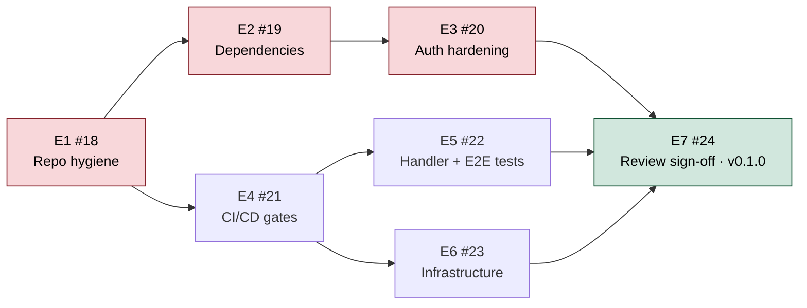

# Production readiness — Kudos as a company service

_Started 2026-11-05 after the hackathon win and the transfer to `openteams-ai`. This folder answers three questions and tracks the work to close the gaps. Diagrams are Mermaid and render on GitHub; the docs paste cleanly into anything that takes Markdown._

| Question | Doc | One-line answer |
|---|---|---|
| **Where are we?** | [`01-where-we-are.md`](01-where-we-are.md) | Product is MVP-worthy for an internal pilot; the repo is not deployable as a service today — dependencies, delivery pipeline, auth boundary, and repo hygiene block it. ~1–2 days plus the Next.js upgrade. |
| **What infra do we need?** | [`02-infrastructure.md`](02-infrastructure.md) | One small VM with `docker compose`: TLS proxy → web (1 replica) + Slack bot (1 replica, outbound-only) → Postgres, migrate job, nightly backups. Kubernetes/Nebari option designed for later. |
| **What does support look like?** | [`03-support.md`](03-support.md) | Two workflows (`ci.yml`, `release.yml`) with typecheck/lint/unit/handler/E2E/audit/CodeQL/gitleaks gates, Trivy + SBOM + cosign on publish, Dependabot grouped auto-merge, a short runbook. |
| **Is it secure enough?** | [`04-security.md`](04-security.md) | Threat model (T1–T15), controls matrix, accepted risks, and the sign-off checklist for the security reviewer. |

## The path, at a glance

Red = blockers found in the review; green = the gate. E1 is an afternoon; E2 is the only piece with real risk (Next 14 → 16). E4/E5/E6 can run in parallel once E1 lands.

## Epics

| Epic | Issue | Closes findings | Size |
|---|---|---|---|
| E1 · Repo hygiene after the org transfer | [#18](https://github.com/openteams-ai/kudos/issues/18) | F2, F4, F11 | S |
| E2 · Dependency upgrade & vulnerability burn-down | [#19](https://github.com/openteams-ai/kudos/issues/19) | F1 · T2 | M–L |
| E3 · Auth & tenancy hardening | [#20](https://github.com/openteams-ai/kudos/issues/20) | F3, F6 · T1, T6, T14 | S |
| E4 · CI/CD pipeline with quality + security gates | [#21](https://github.com/openteams-ai/kudos/issues/21) | F8 · T8, T9 | M |
| E5 · Handler tests + Playwright E2E | [#22](https://github.com/openteams-ai/kudos/issues/22) | F9 | M |
| E6 · Production infrastructure | [#23](https://github.com/openteams-ai/kudos/issues/23) | F5, F7, F10 · T10, T12, T13 | M |
| E7 · DevOps + security review sign-off | [#24](https://github.com/openteams-ai/kudos/issues/24) | gate | S |

Working agreement for a two-person team: the epic *is* the tracker — tick the checklist in the issue, open a sub-issue only when a task grows a discussion of its own. Label everything `production-readiness` so one filter shows the whole effort. Findings are numbered **F1–F11** (`01-where-we-are.md`) and threats **T1–T15** (`04-security.md`) so PRs can say what they close.

## Relationship to the feature roadmap

[`../ROADMAP.md`](../ROADMAP.md) is the *product* plan (merging the other three hackathon entries). This folder is the *platform* plan. They meet in two places: E2 does roadmap **P0a** (stack upgrade) and roadmap **Gate C** (derived balances) is the real fix for finding F5. Do this folder first — the feature work lands on a safer base and ships through the pipeline built here.

## Keeping this current

Update the verdict in `01-where-we-are.md` when an epic closes; move accepted risks out of `04-security.md` when they are fixed; when the runbook has real hostnames, move it to `docs/runbook.md` and link it from here.
